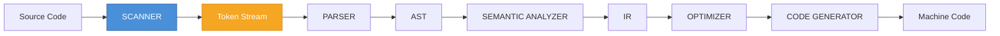
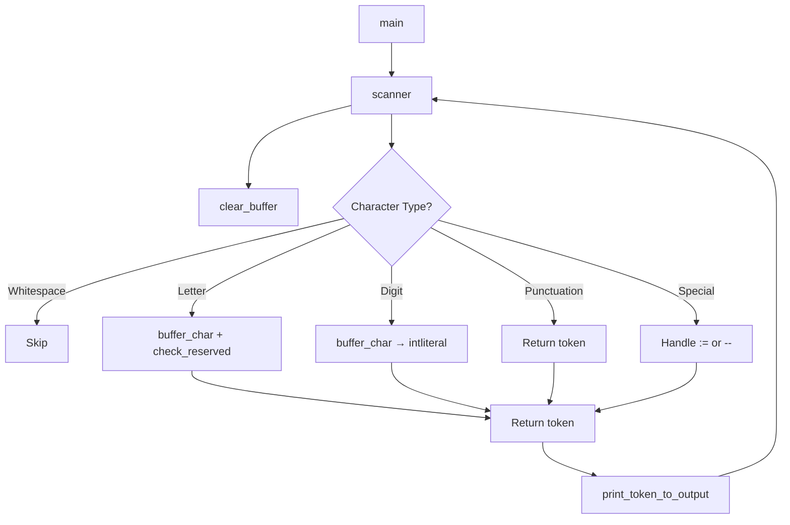
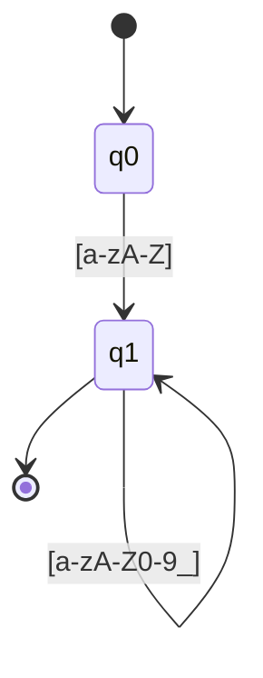

# Micro Language Scanner

<div align="center">


**A lexical analyzer for the Micro educational programming language**

*Demonstrating the fundamental principles of lexical analysis — the first phase of compilation*

[Overview](#-overview) •
[Architecture](#-architecture--design) •
[Building](#-building-the-scanner) •
[Usage](#-running-the-scanner) •
[Theory](#-academic-background--theory) •
[Extensions](#-suggested-extensions-for-further-research)

</div>

---

## 📋 Table of Contents

<details>
<summary>Click to expand</summary>

- [Overview](#-overview)
- [Project Structure](#-project-structure)
- [The Micro Language](#-the-micro-language)
- [Token Specification](#-token-specification)
- [Architecture & Design](#-architecture--design)
- [Detailed Code Walkthrough](#-detailed-code-walkthrough)
- [Building the Scanner](#-building-the-scanner)
- [Running the Scanner](#-running-the-scanner)
- [Sample Inputs & Expected Outputs](#-sample-inputs--expected-outputs)
- [Comparison with Real Compilers](#-comparison-with-real-compilers)
- [Academic Background & Theory](#-academic-background--theory)
- [Limitations & Known Issues](#-limitations--known-issues)
- [Suggested Extensions](#-suggested-extensions-for-further-research)
- [Testing Strategy](#-testing-strategy)
- [License & Acknowledgments](#-license--acknowledgments)
- [Quick Reference Card](#-quick-reference-card)

</details>

---

## 🔍 Overview

This project implements a **scanner** (also called a *lexer* or *tokenizer*) for the **Micro** language. The scanner reads a source file written in Micro, breaks it into a stream of **tokens**, and writes the token stream to an output file.

### Compilation Pipeline



### What the Scanner Recognizes

| Category | Elements |
|----------|----------|
| **Keywords** | `begin`, `end`, `read`, `write` |
| **Identifiers** | `x`, `y`, `counter`, `_temp` |
| **Integer Literals** | `52`, `0`, `001` |
| **Operators** | `:=` (assignment), `+` (plus), `-` (minus) |
| **Punctuation** | `(`, `)`, `;`, `,` |
| **Comments** | `--` to end of line |
| **EOF Marker** | `SCANEOF` |

---

## 📁 Project Structure

```
.
├── 📄 scanner2.c          # The main scanner implementation
├── 🔧 scanner             # Compiled binary (Linux/macOS)
├── 🔧 scanner2            # Alternative compiled binary
├── 📝 test.micro          # Sample Micro program (without begin/end)
├── 📝 test1.micro         # Sample Micro program (with begin/end)
├── 📤 output.txt          # Example token stream from test.micro
└── 📦 repomix-output.xml  # Packed repository representation
```

> **Note:** `scanner` and `scanner2` are compiled binaries and are not human-readable. They are excluded from the packed representation.

---

## 🔤 The Micro Language

Micro is a minimal imperative language used in compiler-construction courses, notably inspired by the language in *Compiler Construction: Principles and Practice* by Kenneth C. Louden.

### Grammar

```ebnf
program     → "begin" stmt_list "end"
stmt_list   → stmt | stmt ";" stmt_list
stmt        → id ":=" expr
            | "read" "(" id_list ")"
            | "write" "(" expr_list ")"
expr        → term { ("+" | "-") term }
term        → factor { ("*" | "/") factor }
factor      → id | int_literal | "(" expr ")"
id_list     → id { "," id }
expr_list   → expr { "," expr }
```

### Lexical Conventions

| Element | Pattern | Example |
|---------|---------|---------|
| Keyword | reserved word | `begin`, `end` |
| Identifier | `letter (letter \| digit \| _)*` | `x`, `a1`, `_t` |
| Integer | `digit+` | `52`, `0`, `001` |
| Assignment | `:=` | `:=` |
| Plus | `+` | `+` |
| Minus | `-` | `-` |
| LParen | `(` | `(` |
| RParen | `)` | `)` |
| Semicolon | `;` | `;` |
| Comma | `,` | `,` |
| Comment | `--` … end of line | `-- this is ok` |
| Whitespace | space, tab, newline | *(ignored)* |

---

## 🏷️ Token Specification

Tokens are defined as an `enum` in C:

```c
typedef enum {
    begin,       // "begin" keyword
    end,         // "end" keyword
    read,        // "read" keyword
    write,       // "write" keyword
    id,          // identifier
    intliteral,  // integer literal
    lparen,      // "("
    rparen,      // ")"
    semicolon,   // ";"
    comma,       // ","
    plusop,      // "+"
    minusop,     // "-"
    assignop,    // ":="
    scan_eof     // end of input
} token;
```

Each token has a **type** and, for identifiers and integer literals, an associated **lexeme** stored in `token_buffer`.

---

## 🏗️ Architecture & Design

The scanner follows the classic **two-buffer / getchar-based** design described in the *Dragon Book*.

### Core Techniques

| Technique | Purpose |
|-----------|---------|
| `fgetc(source)` | Character-by-character input |
| `ungetc(c, source)` | One-character lookahead |
| `token_buffer[256]` | Lexeme accumulation |
| `line_number` | Error reporting |

### Flow of Control



### Lookahead & `ungetc`

After reading a letter, the scanner keeps consuming characters while they are alphanumeric or `_`. When it hits a non-matching character, it *pushes it back* using `ungetc` so the next call to `scanner()` can process it.

> This is a simple form of **one-character lookahead** — the same technique used in hand-written scanners inside real compilers (e.g., GCC's `libcpp/lex.c`).

---

## 📖 Detailed Code Walkthrough

### 1. Header Includes

```c
#include <stdio.h>    // FILE, fopen, fgetc, ungetc, fprintf, printf
#include <ctype.h>    // isspace, isalpha, isalnum, isdigit
#include <stdlib.h>   // exit (currently commented out)
#include <string.h>   // strlen, strcmp
```

### 2. Global State

```c
char token_buffer[256];
FILE *source;
FILE *output;
int line_number = 1;
```

| Variable | Purpose |
|----------|---------|
| `token_buffer` | Holds current lexeme (max 255 chars + null) |
| `source` | Input file handle |
| `output` | Output file handle |
| `line_number` | Tracks current line for diagnostics |

### 3. Buffer Helpers

```c
void clear_buffer(void) { token_buffer[0] = '\0'; }

void buffer_char(int c) {
    int len = strlen(token_buffer);
    token_buffer[len] = (char)c;
    token_buffer[len + 1] = '\0';
}
```

> ⚠️ **Performance Note:** `strlen` on every character makes this O(n²) in lexeme length. A production scanner would keep an index instead. See [Limitations](#-limitations--known-issues).

### 4. Keyword Recognition

```c
token check_reserved(void) {
    if (strcmp(token_buffer, "begin") == 0) return begin;
    if (strcmp(token_buffer, "end")   == 0) return end;
    if (strcmp(token_buffer, "read")  == 0) return read;
    if (strcmp(token_buffer, "write") == 0) return write;
    return id;
}
```

A linear sequence of `strcmp` calls. Real compilers use a **perfect hash** or **trie** for O(1) keyword lookup.

### 5. Error Handling

```c
void lexical_error(int c) {
    printf("Erreur lexicale (ligne %d) : caractere inattendu '%c'\n",
           line_number, c);
    // exit(1);
}
```

Errors are reported but **do not halt** the scanner — allowing recovery and continued scanning, similar to production compilers.

### 6. The Core: `scanner()`

```c
token scanner(void) {
    int in_char, c;
    clear_buffer();
    while ((in_char = fgetc(source)) != EOF) {
        if (in_char == '\n') { line_number++; continue; }
        if (isspace(in_char)) continue;

        else if (isalpha(in_char)) {
            buffer_char(in_char);
            for (c = fgetc(source); isalnum(c) || c == '_'; c = fgetc(source))
                buffer_char(c);
            ungetc(c, source);
            return check_reserved();
        }

        else if (isdigit(in_char)) {
            buffer_char(in_char);
            for (c = fgetc(source); isdigit(c); c = fgetc(source))
                buffer_char(c);
            ungetc(c, source);
            return intliteral;
        }

        else if (in_char == '(') return lparen;
        else if (in_char == ')') return rparen;
        else if (in_char == ';') return semicolon;
        else if (in_char == ',') return comma;
        else if (in_char == '+') return plusop;

        else if (in_char == '-') {
            c = fgetc(source);
            if (c == '-') {                      // comment
                do {
                    in_char = fgetc(source);
                } while (in_char != '\n' && in_char != EOF);
                if (in_char == '\n') line_number++;
            } else {
                ungetc(c, source);
                return minusop;
            }
        }

        else if (in_char == ':') {
            c = fgetc(source);
            if (c == '=') return assignop;
            else { ungetc(c, source); lexical_error(in_char); }
        }

        else { lexical_error(in_char); }
    }
    return scan_eof;
}
```

#### Key Observations

| Feature | Implementation |
|---------|----------------|
| Whitespace | Skipped, line counter incremented on `\n` |
| Identifiers | `isalpha` start, then `isalnum` / `_` |
| Integers | `isdigit` start, then `isdigit` |
| Single-char tokens | Direct `return` for `( ) ; , +` |
| Two-char operators | `-` (comment or minus), `:` + `=` → `:=` |
| Comments | `--` consumed to end of line |
| EOF | `scan_eof` returned |

> 🐛 **Bug Alert:** The comment branch does **not** `return` or `continue` after consuming the comment. Control falls through to the bottom of the `while` loop and reads the next character. In practice this works, but it is fragile. See [Limitations](#-limitations--known-issues).

### 7. Output Functions

`print_token` (to stdout) and `print_token_to_output` (to file) are duplicated logic. Each maps a `token` enum to a human-readable string:

```c
case id:         fprintf(output, "ID(%s)\n", token_buffer); break;
case intliteral: fprintf(output, "INT(%s)\n", token_buffer); break;
```

> 💡 **Refactoring Opportunity:** These two functions could be unified by taking a `FILE *` parameter.

### 8. `main()`

```c
int main(int argc, char *argv[]) {
    if (argc < 3) {
        printf("Usage : %s fichier_source fichier_output\n", argv[0]);
        return 1;
    }
    source = fopen(argv[1], "r");
    output = fopen(argv[2], "w");
    ...
    token t;
    do {
        t = scanner();
        print_token_to_output(t);
    } while (t != scan_eof);
    fclose(source); fclose(output);
    return 0;
}
```

Standard CLI: `scanner <source> <output>`. The loop terminates when `scan_eof` is produced.

---

## 🔨 Building the Scanner

### Prerequisites

| Requirement | Details |
|-------------|---------|
| **Compiler** | GCC, Clang, or MSVC |
| **Build Tool** | *(Optional)* `make` |
| **Shell** | POSIX-like (Linux, macOS, WSL, Git Bash) |

### Compilation

#### Using GCC (Recommended)

```bash
gcc -Wall -Wextra -O2 -o scanner scanner2.c
```

| Flag | Purpose |
|------|---------|
| `-Wall -Wextra` | Enable all warnings |
| `-O2` | Optimize for speed |
| `-o scanner` | Output binary name |

#### Using Clang

```bash
clang -Wall -Wextra -O2 -o scanner scanner2.c
```

#### Debug Build (with Sanitizers)

```bash
gcc -Wall -Wextra -g -fsanitize=address,undefined -o scanner_dbg scanner2.c
```

> ✅ **Highly recommended** for academic work: detects buffer overflows and undefined behavior.

#### Windows (MSVC)

```cmd
cl scanner2.c /Fe:scanner.exe
```

#### Windows (MinGW)

```bash
gcc -Wall -Wextra -O2 -o scanner.exe scanner2.c
```

### Optional Makefile

```make
CC      = gcc
CFLAGS  = -Wall -Wextra -O2 -std=c11
TARGET  = scanner
SRC     = scanner2.c

all: $(TARGET)

$(TARGET): $(SRC)
	$(CC) $(CFLAGS) -o $@ $<

debug: $(SRC)
	$(CC) $(CFLAGS) -g -fsanitize=address,undefined -o $(TARGET)_dbg $<

clean:
	rm -f $(TARGET) $(TARGET)_dbg

.PHONY: all debug clean
```

Then run:

```bash
make          # release build
make debug    # sanitizer build
make clean    # remove binaries
```

---

## 🚀 Running the Scanner

### Basic Usage

```bash
./scanner test.micro output.txt
```

| Argument | Description |
|----------|-------------|
| `test.micro` | Input Micro source file |
| `output.txt` | Destination for token stream |

### With Sanitizer Build

```bash
./scanner_dbg test.micro output.txt
```

### Inspecting the Result

```bash
cat output.txt
```

### Running on Windows

```cmd
scanner.exe test.micro output.txt
type output.txt
```

---

## 📊 Sample Inputs & Expected Outputs

### Input: `test.micro`

```micro
x := 52;
y := 3 + 4;
z := 10;
w := 0.001;
a := x + y;
```

### Output: `output.txt`

```
[ligne 1] ID(x)
[ligne 1] ASSIGNOP
[ligne 1] INT(52)
[ligne 1] SEMICOLON
[ligne 2] ID(y)
[ligne 2] ASSIGNOP
[ligne 2] INT(3)
[ligne 2] PLUSOP
[ligne 2] INT(4)
[ligne 2] SEMICOLON
[ligne 3] ID(z)
[ligne 3] ASSIGNOP
[ligne 3] INT(10)
[ligne 3] SEMICOLON
[ligne 4] ID(w)
[ligne 4] ASSIGNOP
[ligne 4] INT(0)
[ligne 4] INT(001)
[ligne 4] SEMICOLON
[ligne 5] ID(a)
[ligne 5] ASSIGNOP
[ligne 5] ID(x)
[ligne 5] PLUSOP
[ligne 5] ID(y)
[ligne 5] SEMICOLON
[ligne 5] SCANEOF
```

> **Observation:** Line 4 (`w := 0.001;`) is tokenized as `INT(0)` followed by `INT(001)`. The scanner does **not** support floating-point literals or the `.` character. This is a deliberate limitation of the Micro language, highlighting an important lesson: **the scanner's behavior is entirely determined by the language's lexical specification.**

### Input: `test1.micro`

```micro
begin
x := 5.2;
y := 3 + 4;
z := 10;
w := 0.001;
a := x + y;
end
```

> ⚠️ **Expected Behavior:** `begin` and `end` are recognized as keywords (returned by `check_reserved`), but the `print_token_to_output` switch **does not have cases for `begin` and `end`**, so they fall into the `default:` branch and print `ERREUR`. This is a **bug** — see [Limitations](#-limitations--known-issues).

---

## ⚖️ Comparison with Real Compilers

| Aspect | This Scanner | GCC / Clang / MSVC | Java Compiler (`javac`) |
|--------|--------------|-------------------|-------------------------|
| **Lexer Generator** | Hand-written | Hand-written (GCC), Table-driven (Clang) | Hand-written (Unicode-aware) |
| **Character Encoding** | ASCII only | UTF-8, UTF-16, UTF-32, locale-aware | Full Unicode |
| **Lookahead** | 1 character (`ungetc`) | 1–2 characters, sometimes arbitrary | Unlimited via `Reader` |
| **Keyword Lookup** | Linear `strcmp` chain | Perfect hash / trie | Hash table |
| **Buffer Management** | Fixed 256-byte buffer | Growable, memory-mapped, sentinel-based | Growable `StringBuilder` |
| **Error Recovery** | Prints error, continues | Prints error, continues, resyncs | Prints error, continues |
| **Comments** | `--` to EOL | `//`, `/* */`, `#`, `--` | `//`, `/* */`, `/** */` |
| **Numeric Literals** | Integers only | Integers, floats, hex, octal, binary | Integers, floats, hex, octal, binary |
| **String Literals** | Not supported | Supported, escapes, raw strings | Supported, escapes, text blocks |
| **Preprocessor** | None | Full C preprocessor | None (annotations instead) |
| **Position Tracking** | Line only | Line + column + file | Line + column + file |
| **Performance** | ~µs per token | ~ns per token | ~ns per token |
| **Standard Compliance** | Ad-hoc | ISO C / ISO C++ | JLS |
| **Testing** | Manual | Massive test suites, fuzzing | Massive test suites, JCK |

### Deeper Comparisons

#### 1. Lexer Generators vs. Hand-Written Scanners

Real compilers rarely use tools like **Lex/Flex** for their main lexer:

| Compiler | Lexer Location | Approach |
|----------|----------------|----------|
| **GCC** | `libcpp/lex.c` | Hand-written for performance |
| **Clang** | `clang/lib/Lex/` | Hand-written, table-driven |
| **Java** | `src/jdk.compiler/.../Scanner.java` | Hand-written |

Hand-written scanners are preferred because:
- They handle context-sensitive cases (e.g., `>>` in C++ templates vs. shift operator) more easily.
- They are faster (no table lookup overhead in the hot path).
- They integrate better with the parser (e.g., parser feedback into the lexer).

> This project is a **hand-written scanner**, aligning with industry practice.

#### 2. Token Representation

| Approach | This Project | Real Compilers |
|----------|--------------|----------------|
| **Type** | `enum` | Rich struct/class |
| **Lexeme** | Global `token_buffer` | Stored in token |
| **Location** | Global `line_number` | `SourceLocation` (file, line, column) |
| **Value** | Global buffer | Union/`std::variant` |

```c
// Simplified Clang token
class Token {
    tok::TokenKind Kind;     // token type
    SourceLocation Location; // file, line, column
    const char *Spelling;    // lexeme
    ...
};
```

> The lesson: **tokens should carry source location and lexeme**, not rely on globals.

#### 3. Error Recovery

Real compilers distinguish:
- **Lexical errors** — reported, skipped
- **Syntactic errors** — reported, parser resynchronizes
- **Semantic errors** — reported, may continue

This scanner only handles lexical errors, and even then, only prints them. A production scanner would maintain a list of errors, use a `Diagnostic` object with severity levels, and support `#pragma` and suppression.

#### 4. Unicode and Locale

`isalpha` and `isdigit` are **locale-dependent** and only handle ASCII by default. Real compilers use Unicode character databases (e.g., ICU), support identifiers like `café`, `变量`, `переменная`, and handle normalization forms (NFC, NFD).

#### 5. Performance Considerations

| Technique | This Scanner | Production Lexers |
|-----------|--------------|-------------------|
| Character classification | `ctype.h` | Lookup tables, SIMD |
| Buffer growth | Fixed 256 | Dynamic, doubling |
| Keyword lookup | `strcmp` | Perfect hash, trie |
| I/O | `fgetc` | Memory-mapped files, buffered reads |
| Token allocation | Stack/global | Arena allocators |

> A production lexer can tokenize **millions of tokens per second**. This scanner is orders of magnitude slower, but its simplicity is its pedagogical strength.

---

## 📚 Academic Background & Theory

### The Role of the Scanner in Compilation

The scanner performs **lexical analysis**: converting a stream of characters into a stream of tokens. It is the **first phase** of compilation and interfaces directly with the **parser** (syntax analysis).

Formally, the scanner implements a **regular language** recognizer. Each token class is described by a **regular expression**, which is compiled into a **finite automaton** (DFA or NFA). The scanner is essentially a **DFA simulator**.

### Regular Expressions for Micro Tokens

| Token | Regular Expression |
|-------|-------------------|
| `begin` | `begin` |
| `end` | `end` |
| `read` | `read` |
| `write` | `write` |
| `id` | `[a-zA-Z][a-zA-Z0-9_]*` |
| `intliteral` | `[0-9]+` |
| `assignop` | `:=` |
| `plusop` | `+` |
| `minusop` | `-` |
| `lparen` | `(` |
| `rparen` | `)` |
| `semicolon` | `;` |
| `comma` | `,` |
| comment | `--[^\n]*` |
| whitespace | `[ \t\n]+` |

### Finite Automaton for Identifiers



- `q0` is the start state
- `q1` is the accepting state
- The scanner implements this DFA implicitly via the `isalpha` / `isalnum` loop

### The Maximal Munch Rule

The scanner follows the **maximal munch** (longest match) rule: it consumes as many characters as possible while still matching a token.

| Input | Tokenization | Reason |
|-------|--------------|--------|
| `:=` | `ASSIGNOP` | Preferred over `:` + `=` |
| `123abc` | `INT(123)` then `ID(abc)` | Digits stop integer, letter starts identifier |

> This rule is universal across compilers (C, C++, Java, Python, etc.).

### References

1. Aho, A. V., Lam, M. S., Sethi, R., & Ullman, J. D. (2006). *Compilers: Principles, Techniques, and Tools* (2nd ed.). Pearson. — **The Dragon Book**, Chapters 3.1–3.4.
2. Louden, K. C. (1997). *Compiler Construction: Principles and Practice*. PWS Publishing. — Origin of the Micro language.
3. Levine, J. R. (2009). *Flex & Bison*. O'Reilly Media.
4. Parr, T. (2013). *The Definitive ANTLR 4 Reference*. Pragmatic Bookshelf.
5. GCC source: `libcpp/lex.c`, `gcc/cp/lex.c`.
6. Clang source: `clang/lib/Lex/Lexer.cpp`.
7. OpenJDK source: `src/jdk.compiler/share/classes/com/sun/tools/javac/parser/Scanner.java`.

---

## ⚠️ Limitations & Known Issues

### 1. Missing Keyword Cases in Output

`print_token_to_output` has no `case begin:` or `case end:`. As a result, `begin` and `end` fall into `default:` and print `ERREUR`.

**Fix:**

```c
case begin:  fprintf(output, "BEGIN\n");  break;
case end:    fprintf(output, "END\n");    break;
case read:   fprintf(output, "READ\n");   break;
case write:  fprintf(output, "WRITE\n");  break;
```

### 2. O(n²) Buffer Append

`buffer_char` calls `strlen` on every character. For long identifiers or numbers, this is quadratic.

**Fix:**

```c
int token_len = 0;
void clear_buffer(void) { token_len = 0; token_buffer[0] = '\0'; }
void buffer_char(int c) { token_buffer[token_len++] = (char)c; token_buffer[token_len] = '\0'; }
```

### 3. Fixed-Size Buffer (256 bytes)

Longer lexemes cause a **buffer overflow**.

**Fix:** Bounds-check in `buffer_char`, or use dynamic allocation.

### 4. `ungetc` Only Guarantees One Character

`ungetc` is only guaranteed to push back **one** character by the C standard. Pushing back more is implementation-defined. This scanner pushes back at most one at a time, so it is safe, but it is a constraint to remember.

### 5. No Column Tracking

Only `line_number` is tracked. Real compilers report `line:column` for diagnostics.

**Fix:** Add `int column = 1;` and increment on every `fgetc`.

### 6. No `read`/`write` Handling in Output Switch

Same as the keyword issue — these tokens are returned by `check_reserved` but not printed.

### 7. Comment Fall-Through

After consuming a comment, the code does not `continue` or `return`. It falls through to the end of the `while` body, then loops. This works but is unclear.

**Fix:** `continue;` after the comment loop.

### 8. No Handling of `*`, `/`, `=`, `<`, `>`

The Micro language as specified here does not include them, but if the language is extended, the scanner must be updated.

### 9. No Floating-Point Support

`0.001` is tokenized as two integers. If Micro is extended to support floats, the scanner needs a `floatliteral` token and a `.` handler.

### 10. Global State

`source`, `output`, `token_buffer`, and `line_number` are globals. This makes the scanner non-reentrant and hard to test.

**Fix:** Encapsulate in a `struct Scanner`.

---

## 🔬 Suggested Extensions for Further Research

| # | Extension | Description |
|---|-----------|-------------|
| 1 | **Add a Parser** | Use recursive descent or yacc/bison to build a parser on top of the scanner |
| 2 | **Add a Symbol Table** | Track identifiers and their attributes (type, scope, value) |
| 3 | **Add Type Checking** | Extend Micro with `int` and `float` types, implement a type checker |
| 4 | **Generate Intermediate Code** | Emit three-address code or a simple stack-based IR |
| 5 | **Add Unicode Support** | Replace `isalpha`/`isdigit` with Unicode-aware functions |
| 6 | **Add a Lexer Generator** | Implement a small Lex-like tool that reads regex and produces a DFA |
| 7 | **Benchmark Against Real Compilers** | Use `perf` or `valgrind` to profile the scanner |
| 8 | **Fuzz Testing** | Use AFL or libFuzzer to fuzz the scanner with random inputs |
| 9 | **Formal Verification** | Model the scanner in Coq or TLA+ and prove properties |
| 10 | **Error Recovery Strategies** | Implement panic-mode, phrase-level, and error productions |
| 11 | **Parallel Scanning** | Explore parallel lexing by splitting input into chunks |
| 12 | **Incremental Scanning** | Implement an incremental lexer for IDE use |

---

## 🧪 Testing Strategy

### Unit Tests

Create a set of `.micro` files, each testing one feature:

| File | Tests |
|------|-------|
| `test_keywords.micro` | `begin`, `end`, `read`, `write` |
| `test_ids.micro` | Identifiers with `_` and digits |
| `test_ints.micro` | Integers, leading zeros |
| `test_ops.micro` | `:=`, `+`, `-` |
| `test_punct.micro` | `(`, `)`, `;`, `,` |
| `test_comments.micro` | `--` comments |
| `test_errors.micro` | Illegal characters |
| `test_empty.micro` | Empty file |
| `test_eof.micro` | File without trailing newline |

### Golden Tests

For each input, store the expected output. Run the scanner and diff:

```bash
./scanner test_keywords.micro out.txt
diff out.txt expected/test_keywords.out
```

### Sanitizer Tests

Run all tests under ASan/UBSan:

```bash
make debug
for f in tests/*.micro; do ./scanner_dbg "$f" /dev/null; done
```

### Fuzzing

```bash
# Using AFL
afl-gcc -o scanner_afl scanner2.c
afl-fuzz -i seeds/ -o findings/ ./scanner_afl @@ /dev/null
```

### Continuous Integration

Add a `.github/workflows/ci.yml` to build and test on Linux, macOS, and Windows.

---

## 📜 License & Acknowledgments

This project is an educational implementation of a scanner for the **Micro** language, inspired by:

- Kenneth C. Louden, *Compiler Construction: Principles and Practice*.
- Aho, Lam, Sethi, Ullman, *Compilers: Principles, Techniques, and Tools*.

It is intended for **academic use**. Feel free to fork, extend, and use it in courses on compiler construction.

### Suggested Citation

```bibtex
@misc{micro_scanner,
  title  = {Micro Language Scanner},
  author = {Anonymous},
  year   = {2024},
  note   = {Educational lexical analyzer in C},
  url    = {https://github.com/example/micro-scanner}
}
```

---

## 🗂️ Quick Reference Card

### Build Commands

```bash
# Build
gcc -Wall -Wextra -O2 -o scanner scanner2.c

# Run
./scanner test.micro output.txt

# View output
cat output.txt

# Debug build
gcc -g -fsanitize=address,undefined -o scanner_dbg scanner2.c
./scanner_dbg test.micro output.txt
```

### Token Reference

| Token | Output String | Example |
|-------|---------------|---------|
| Identifier | `ID(name)` | `ID(x)` |
| Integer | `INT(value)` | `INT(52)` |
| `:=` | `ASSIGNOP` | |
| `+` | `PLUSOP` | |
| `-` | `MINUSOP` | |
| `(` | `LPAREN` | |
| `)` | `RPAREN` | |
| `;` | `SEMICOLON` | |
| `,` | `COMMA` | |
| EOF | `SCANEOF` | |

### Common Issues

| Issue | Solution |
|-------|----------|
| `begin`/`end` print `ERREUR` | Add cases to output switch |
| Buffer overflow | Increase `token_buffer` size or bounds-check |
| Slow on long identifiers | Replace `strlen` with index counter |

---

<div align="center">

**⭐ Star this repository if you find it useful! ⭐**

*Made with ❤️ for compiler construction education*

[Back to Top](#micro-language-scanner)

</div>
